<div align="center">

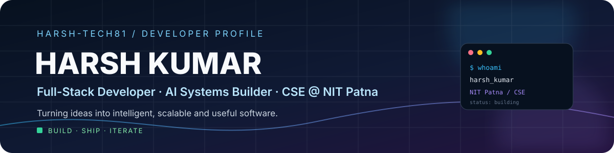

<p align="center">
  <a href="https://github.com/Harsh-tech81">
    
  </a>
  &nbsp;
  <a href="https://linkedin.com/in/harsh-kumar-1ba21731a">
    
  </a>
  &nbsp;
  <a href="https://portfolio-client-swart-phi.vercel.app">
    
  </a>
  &nbsp;
  <a href="mailto:harshkr.221104@gmail.com">
    
  </a>
</p>


</div>

---

## `$ whoami`

I'm **Harsh Kumar**, a Computer Science and Engineering student at **NIT Patna**. I enjoy building complete software products — from responsive interfaces and reliable backend APIs to AI-powered workflows and data-driven applications.

My current interests sit at the intersection of **Full-Stack Engineering, Generative AI, Agentic AI, and distributed applications**. I like understanding how systems work end-to-end, turning ideas into practical products, and improving them through iteration.

<div align="center">
  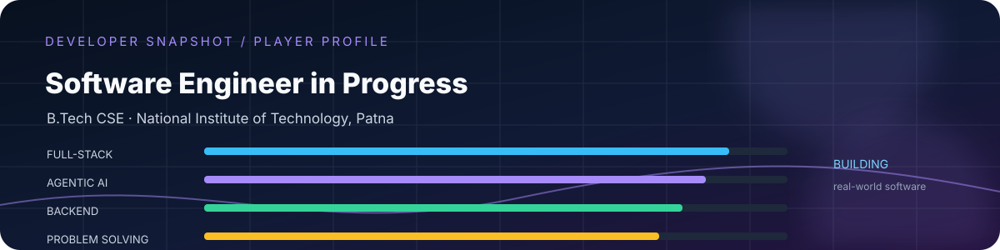
</div>

```js
const harsh = {
  education: "B.Tech in Computer Science & Engineering — NIT Patna",
  interests: ["Full-Stack Engineering", "Agentic AI", "RAG", "Distributed Systems"],
  languages: ["C++", "Java", "JavaScript", "TypeScript", "Python"],
  currentlyExploring: ["Multi-Agent Workflows", "LLM Applications", "Cloud Architecture"],
  engineeringMindset: ["Build", "Measure", "Learn", "Iterate"]
};
```

---

## `$ selected_work`

I focus on projects that combine useful product features with meaningful engineering challenges. Here are a few builds that represent the work I enjoy.

### 01 · PlaceAI — AI Campus Placement Portal

<div align="center">
  <a href="https://github.com/Harsh-tech81/AI-Campus-Placement-Portal">
    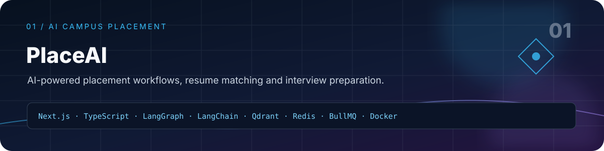
  </a>
</div>

An AI-powered campus placement platform with recruiter workflows, candidate management, resume-job matching, candidate scoring, skill-gap analysis, and personalized interview preparation.

**Engineering highlights:** LangGraph multi-agent workflows, RAG with Qdrant vector search and Gemini embeddings, Redis, BullMQ, and role-based application features.

<div align="center">

  <p>
    
    
    
    
    
    
    
    
    
    
  </p>

  <a href="https://github.com/Harsh-tech81/AI-Campus-Placement-Portal">
    
  </a>
  <a href="https://ai-campus-placement-portal.vercel.app">
    
  </a>

</div>

###   02 · AgentFlow AI — Multi-Agent AI Platform

<div align="center">
  <a href="https://github.com/Harsh-tech81/Multi-Agent-AI-Platform">
    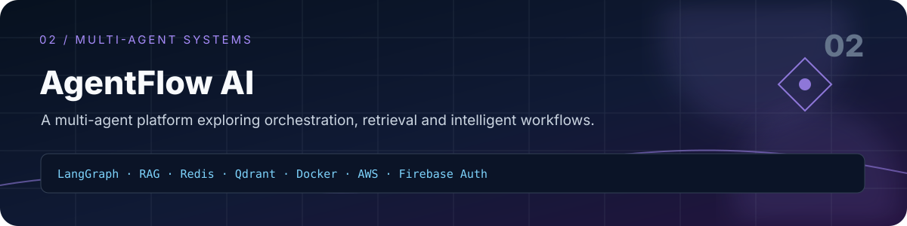
  </a>
</div>

A multi-agent AI platform focused on orchestrating specialized agents and combining retrieval-augmented generation with scalable supporting services.

<div align="center">

  <p>
    
    
    
    
    
    
    
  </p>

  <a href="https://github.com/Harsh-tech81/Multi-Agent-AI-Platform">
    
  </a>

</div>

### 03 · NovaChat — AI Chat & Image Generation

<div align="center">
  <a href="https://github.com/Harsh-tech81/NovaChat">
    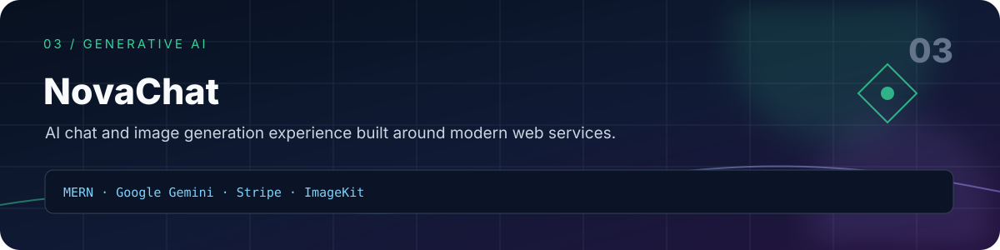
  </a>
</div>

An AI chatbot and image-generation application built around Google's Gemini model, with payments and media delivery integrated into a MERN-based product.

<div align="center">

  <p>
    
    
    
    
    
    
    
  </p>

  <a href="https://github.com/Harsh-tech81/NovaChat">
    
  </a>
  <a href="https://nova-chat-rouge.vercel.app">
    
  </a>

</div>

### 04 · Ecommerce Shopping Website

<div align="center">
  <a href="https://github.com/Harsh-tech81/Ecommerce-Shopping-Website">
    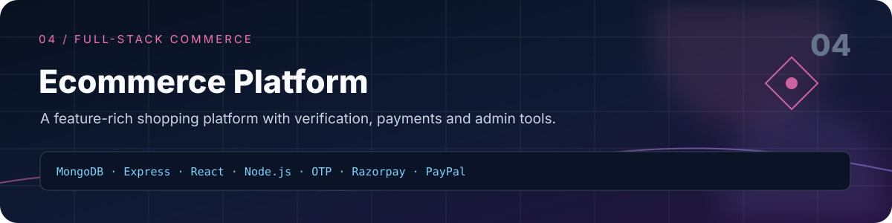
  </a>
</div>

A full-stack ecommerce platform with OTP/email verification, payment integrations, product management, and an admin dashboard.

<div align="center">

  <p>
    
    
    
    
    
    
  </p>

  <a href="https://github.com/Harsh-tech81/Ecommerce-Shopping-Website">
    
  </a>
  <a href="https://splendorous-marzipan-2ace59.netlify.app">
    
  </a>
  <a href="https://bejewelled-sunshine-44d5ba.netlify.app">
    
  </a>

</div>

<details>
<summary><b>Explore More Projects</b></summary>

### Personal Portfolio

<p>A portfolio showcasing my projects, technical skills and developer journey.</p>

<a href="https://github.com/Harsh-tech81/Portfolio">
  
</a>
<a href="https://portfolio-client-swart-phi.vercel.app">
  
</a>

---

### Get Me A Chai

<p>A creator crowdfunding platform with authentication and payment flow.</p>

<a href="YOUR_GETMEACHAI_GITHUB_REPOSITORY">
  
</a>

</details>


## `$ achievements --milestones`

<div align="center">
  <a href="https://drive.google.com/file/d/14N9tWixD_UtdXh7siSgcK3QQnIstW-kT/view">
    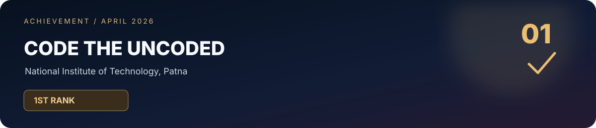
  </a>
  <br/><br/>
  <a href="https://drive.google.com/file/d/1ND9FE4qyr5j-7G6VxfMQ8RgtJ-Sf7RCu/view">
    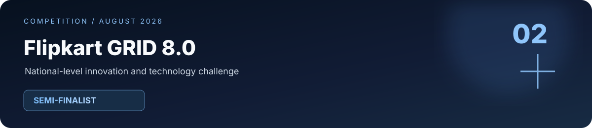
  </a>
</div>

## `$ certifications --verified_learning`

<div align="center">
  <a href="https://drive.google.com/file/d/1K6aDyjAKwlNrC1_IIbCLFgREex_2o8H-/view">
    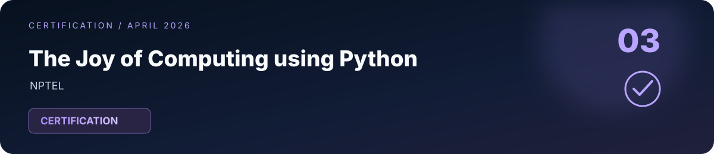
  </a>
</div>


## `$ problem_solving --journey`

I believe strong software engineering starts with strong problem-solving fundamentals. I practice Data Structures & Algorithms and competitive programming to sharpen algorithmic thinking, write efficient solutions, and approach unfamiliar problems methodically.

<div align="center">

<a href="https://leetcode.com/u/Harsh_kr-123">
  
</a>
&nbsp;
<a href="https://codeforces.com/profile/harshkr.221104">
  
</a>
<br/><br/>
<a href="https://www.codechef.com/users/harshkumar12">
  
</a>
&nbsp;
<a href="https://www.geeksforgeeks.org/profile/harshkrrrpu?tab=activity">
  
</a>

</div>

**Problem-solving focus:** Data Structures · Algorithms · Dynamic Programming · Graph Algorithms · Binary Search · Trees · Competitive Programming

---


## `$ stack --loadout`

<div align="center">
  
  <br/><br/>
  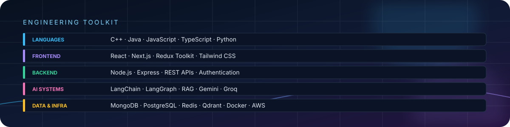
</div>

**AI & LLM ecosystem:** LangChain · LangGraph · RAG · Google Gemini · Groq · Qdrant

**Backend & systems:** REST APIs · JWT · Role-Based Access Control · Redis · BullMQ · Socket.IO

**Cloud & delivery:** Docker · AWS · Vercel · Netlify · Render · Git

---

## `$ activity --signal`

<div align="center">
  
  
  <br/>
  
</div>

> The overview and language cards are generated and committed to this repository by GitHub Actions once a day. Language percentages reflect detected repository code, not overall proficiency.

---

## `$ currently_learning`

- Designing reliable multi-agent workflows and tool-using AI systems.
- Building better RAG pipelines and LLM-powered applications.
- Exploring cloud architecture, containerization, and scalable backend design.
- Strengthening problem-solving and data structures through C++.

---

## `$ beyond_the_code`

- **Problem solving:** I enjoy breaking down complex problems into smaller, testable steps.
- **Project-first learning:** I learn best by implementing concepts in working applications.
- **Collaboration:** Open to meaningful collaboration on AI, backend, and full-stack projects.

---

## `$ open_a_connection`

If you're building something interesting, exploring an engineering problem, or have an opportunity to discuss, feel free to reach out.

<div align="center">
  <a href="https://linkedin.com/in/harsh-kumar-1ba21731a"></a>
  <a href="mailto:harshkr.221104@gmail.com"></a>
  <a href="https://portfolio-client-swart-phi.vercel.app"></a>
  <a href="https://github.com/Harsh-tech81"></a>
</div>

<div align="center">
  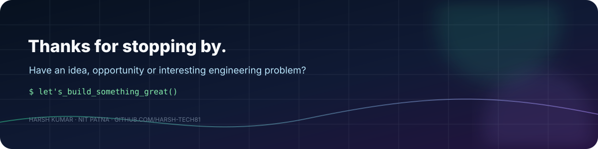
  <sub>Building, learning and shipping — one meaningful commit at a time.</sub>
</div>
